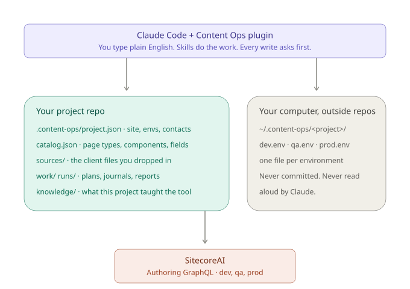
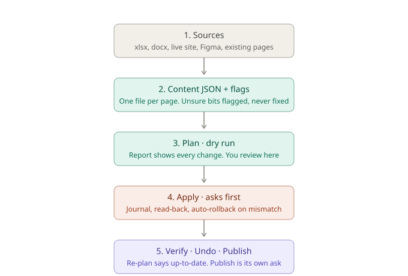
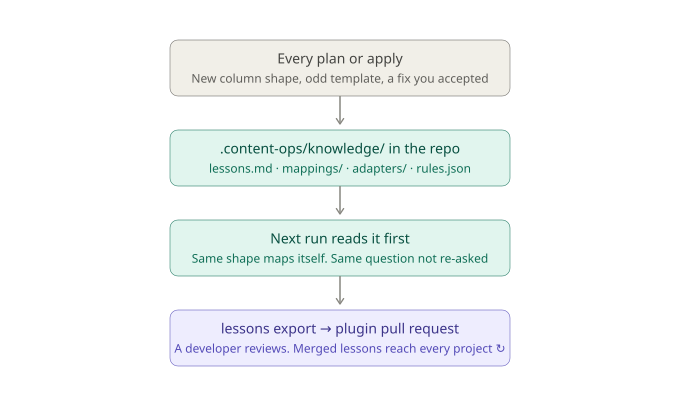

# Content Ops

Content Ops lets a content team author Sitecore XM Cloud pages from the files clients send, with every write planned first, journaled, verified and undoable. A developer sets a project up once in about ten minutes. After that, authors do everything in plain English inside Claude Code, and the tool never writes to Sitecore without an explicit yes.

| | Content Ops framework | Everyday Claude for Sitecore |
|---|---|---|
| What | Engine plus plugin any Sitecore XM Cloud project drops in | Authors use Claude Code for day-to-day admin, analysis, fixes and reports |
| Who sets up | A developer, once per project | Nobody. The plugin plus a credentials file |
| Who uses | Authors through skills, developers through the CLI | Authors, in plain English |
| What changes | Bulk authoring without copy and paste | From typist to verifier, consultant and strategist |

## Where things live

<!-- diagram: where-things-live -->

The plugin runs inside Claude Code. The project repo holds the configuration, the catalog of page types and components, the client files, the plans and the journals. Credentials live on your computer outside every repo and are never printed. Sitecore is reached through its Authoring GraphQL API, one environment at a time.

## Ten minutes to first read (developer)

1. In Claude Code, open the project folder and say **"set up content ops here"**. The setup skill asks a few questions (site root, home path, environment names, who to ask) and runs `content-ops setup --answers <file>`. You get a `.content-ops/` folder with `project.json` and an empty `knowledge/` folder.
2. Say **"copy the credentials from my .env.local for dev"**. Claude runs `content-ops setup --from-env-local <path> --env dev`. Three settings move to `~/.content-ops/<project>/dev.env` with mode 600. Claude never shows them. Expected output: the host and the first four characters of the client id.
3. Say **"check the connection"**. Claude runs `content-ops check --project <name> --env dev`. Expected: `credentials: ok`, `connection: ok`.
4. Say **"build the catalog"**. Claude runs `content-ops catalog build --env dev`. With no blueprint folder it picks one real page per page template from the site (the one using the most components) and reads page types, components and fields from those. Expected: a list of page types, a component count, no errors. Optional: a `Home/_blueprints` folder with one page per template carrying every allowed component gives a complete catalog on day one. Later changes use `content-ops catalog refresh --env dev`, which never deletes.
5. Commit `.content-ops/` so authors get it. Add `sources/`, `work/` and `runs/` to `.gitignore`.

## Five minutes to join a project that is already set up (anyone)

1. Get the project repo (clone, pull or unzip) and open it in Claude Code. Say **"set up content ops for this project"**.
2. Claude sees `.content-ops/` is there, so it does not ask the setup questions. It runs `content-ops setup join`: `~/.content-ops/<project>/` is created with an empty `<env>.env` for each non-production environment, and you get a short list of what is still missing.
3. Open the placeholder file in a text editor, paste the three values a developer gives you after the `=` signs, and save. Never paste them into chat.
4. Say **"check the connection"**. Expected: `credentials: ok`, `connection: ok`.

## Ten minutes to first safe write (author)

1. Open the project folder in Claude Code. Production is reachable only with a production credentials file, and then every write says PRODUCTION and asks.
2. Say **"what page types and components do we have?"** Claude reads the catalog. No Sitecore call, no write.
3. Say **"make me an intake sheet for Location pages"**. Claude runs `content-ops template --page-type <key>` and hands you a spreadsheet whose columns are exactly the fields Sitecore has. This is the format you give clients.
4. Fill two rows with dummy content, drop the file in `sources/`, and say **"plan it"**. Claude runs intake and `content-ops plan --env dev --content work/`. You get a dry-run report. Nothing was written.
5. Say **"apply this on dev"**. Claude restates the environment, the host, prod yes or no, and the page count, then asks. Say yes in your own words. Claude runs `content-ops apply --run <id> --confirm dev`.
6. Say **"verify"**. Claude re-plans the written pages. Expected: every page `up-to-date`.
7. Say **"undo that"**. Claude restores the page from its journal and asks first.

## The daily loop

<!-- diagram: daily-loop -->

Sources become content JSON with flags for anything unsure. The plan is a promise you can read. Apply is the act, journaled and read back. Verify proves it. Publish is always its own ask.

## Who can do what

There are no roles to set. Everyone gets the same gates; what you can reach depends on the credentials files a developer gives you.

| | Everyone |
|---|---|
| Can | read, intake, plan, apply with a yes, verify, undo, reports, lessons; setup and catalog are usually done by a developer |
| Refused | anything without `--confirm`; production writes without a production credentials file; Sitecore serialization push |
| Asks first | every Sitecore write, credentials copy, and any recursive delete |
| Credentials | `dev.env` and `qa.env`; `prod.env` only when the project lead gives it |

## Safety in one screen

1. Every Sitecore write asks first and restates environment, host, prod yes or no, and scope.
2. Production needs a production credentials file. With it, every production write is announced as PRODUCTION and asks again.
3. Every write is journaled before it happens, read back after, and rolled back on mismatch.
4. Undo is one command per page from the journal. Say "undo that" after any apply.
5. Shared datasources are never edited. Unknown components are refused.
6. Client copy is never corrected. Problems become flags with a locator.
7. Credentials are never printed, read aloud or committed.
8. Publish is a separate ask. Nothing publishes as a side effect.

## How it learns

<!-- diagram: learning-loop -->

Every confirmed sheet shape, deck shape and rule override is remembered in `.content-ops/knowledge/` with where it came from. The same shape never asks twice. Lessons are plain words, appended, never rewritten. `content-ops lessons export` bundles the shareable ones so a developer can open a pull request against the plugin. Nothing changes the shared plugin by itself.

When a task needs something new (a shared datasource, records under Data, a page swap, repointing references), Claude builds it as an **operation** in `.content-ops/operations/`. The operation only reads and proposes changes; the engine writes them with the same dry run, confirmation, journal, read-back and undo as everything else. The operation is committed with the project, so the next person reuses it, and a general one is promoted into the plugin. The plugin starts with playbooks from the reference project, so it already knows how those cases were solved.

## Using it without content work

Even a project with no migration gets three things. The catalog is living documentation of page types, components and fields, rebuilt from the blueprint pages. `content-ops export` and `content-ops scan` turn existing pages into readable files and reference maps for audits. `content-ops template` gives clients a standard sheet to fill before any content arrives.

## FAQ

**It asked me to confirm. What do I check?** The environment name, the host, prod yes or no, and the page count. If any of those surprise you, say no.

**It says needs-review. Is that bad?** No. It means the tool refused to guess. Read the reasons, fix the source or the catalog, and plan again.

**Can I break prod?** Only if you have the production credentials file and say yes to a prompt that says PRODUCTION. Without the file, nothing reaches it.

**The client sent a sheet in their own format.** Drop it in `sources/` and run intake. The tool proposes a mapping once, you confirm it, and the same shape never asks again.

**What does pending mean on a report?** Something was held, not written: a placeholder token, a link to a page that does not exist yet, a component changed on the blueprint. Each line says why.

**How do I see what happened last week?** `content-ops history --env dev` lists every page written from the journals. `content-ops report --combined --env dev` makes one page you can share.

**It wrote the wrong thing.** Say "undo that page". The journal holds the exact previous values.

**Can I publish?** Only as its own ask, after verify, and never as part of apply.

**Where are the secrets?** In `~/.content-ops/<project>/<env>.env` on your computer, outside every repo. Claude does not read them.

**Who do I ask?** `contacts` in `.content-ops/project.json` names the developer and the content lead for this project.

## Links

- Plugin: the `plugin/` folder of the content-ops engine repo. Install it in Claude Code from the repo's marketplace.
- Training hub: the kickoff deck and the session guide, from your project lead.
- For developers: the engine design spec and this phase's plan live in `docs/superpowers/` of the project that commissioned the tool.
